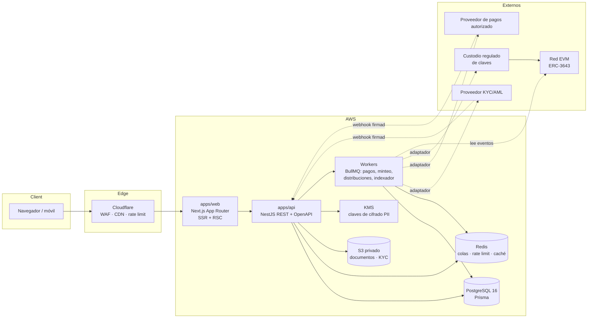
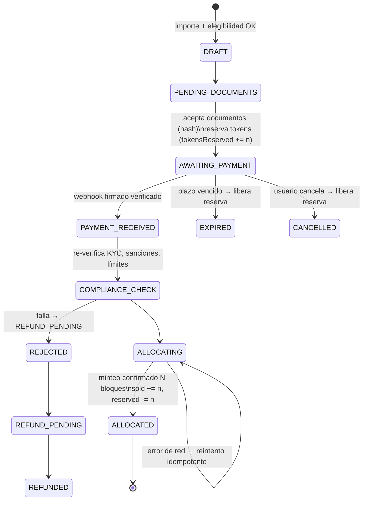

# Arquitectura técnica — Japan Property Token

Estado: **Fases 1–2 completadas, Fase 3 completada a falta de verificación en tu equipo** (ver §9). Datos exclusivamente DEMO.

## 1. Vista general



Principios:

- **El backend decide; el frontend muestra.** Ningún estado económico (pago, emisión, distribución) cambia por una señal del navegador.
- **La base de datos es la fuente de verdad legal.** La blockchain refleja el registro de titulares; un indexador concilia ambos.
- **Integraciones detrás de puertos.** KYC, pagos, custodia, almacenamiento y notificaciones son interfaces con adaptador `mock` en desarrollo. Ninguna integración real está inventada.
- **Módulos regulados apagados por defecto** (`packages/shared/src/regulatory.ts`, `docs/LEGAL_MODEL.md` §6).
- **Dinero en enteros.** JPY en `bigint`, tasas en puntos básicos, participaciones en ppm. Sin coma flotante en ninguna cifra monetaria; en JSON viaja como cadena decimal.

## 2. Monorepo

```
apps/
  web/            Next.js 15 (App Router) — marketplace, ficha, dashboard, admin
  api/            NestJS 11 — REST /v1, OpenAPI en /docs
packages/
  shared/         Dominio puro: dinero, métricas, simulador, gates regulatorios,
                  esquemas Zod de consulta, DTOs, datos DEMO  (probado)
  database/       Prisma schema, migraciones SQL, invariantes, seed DEMO
  ui/             Componentes base (design system)
  contracts/      Solidity / Foundry (Fase 4)
  config/         tsconfig compartidos
infra/
  docker/         docker-compose, Dockerfiles
  deployment/     Notas de despliegue AWS / Cloudflare
docs/             Arquitectura, modelo legal, seguridad
```

Herramientas: pnpm workspaces + Turborepo. Node 22 LTS.

## 3. Stack definitivo

| Capa | Elección | Motivo |
|---|---|---|
| Web | Next.js 15, React 19, TypeScript, Tailwind CSS 4, componentes estilo shadcn/ui, Framer Motion, TanStack Query, React Hook Form + Zod | Lo pedido en el brief; RSC para SEO y rendimiento en fichas |
| API | NestJS 11, Prisma 6, PostgreSQL 16, Redis 7, BullMQ, Pino, Helmet, @nestjs/throttler, Swagger | Modularidad, DI, validación, OpenAPI |
| Auth | Sesiones opacas en cookie `HttpOnly; Secure; SameSite=Lax` + hash en BD, Argon2id, TOTP, CSRF double-submit | Revocables al instante; sin JWT de larga vida en el navegador |
| Contratos | Solidity 0.8.x, OpenZeppelin 5, Foundry, Slither, ERC-3643 (T-REX) | Estándar de tokens permisionados con registro de identidad y módulos de compliance |
| Infra | Docker, GitHub Actions, AWS (ECS Fargate, RDS, ElastiCache, S3, KMS, Secrets Manager), Cloudflare | Gestionado, auditable |
| Observabilidad | OpenTelemetry → CloudWatch/Grafana, logs JSON (Pino) con `requestId`, Sentry | Trazabilidad extremo a extremo |

## 4. Red blockchain

Evaluación (la red **no** determina la legalidad del producto):

| Criterio | Ethereum L1 | Polygon PoS | Base (L2 OP Stack) |
|---|---|---|---|
| Coste por transacción | Alto | Muy bajo | Muy bajo |
| Seguridad | Máxima | Validadores propios | Hereda de Ethereum (rollup) con secuenciador centralizado |
| Liquidez potencial de RWA | Alta | Media | Media |
| Herramientas (Foundry, Safe, indexadores) | Completas | Completas | Completas |
| Custodios institucionales | Amplio soporte | Amplio | Creciente |
| ERC-3643 | Sí | Sí | Sí (EVM) |

Decisión:

1. **Contratos agnósticos de red** (EVM estándar, sin dependencias de precompilados).
2. **Desarrollo y testnet:** Base Sepolia (coste nulo, herramientas maduras, finalidad anclada a Ethereum).
3. **Producción: decisión diferida al socio licenciado.** Las emisiones japonesas reguladas se apoyan en plataformas de ST operadas por entidades con licencia, y la red la impone en la práctica la colocadora/custodio. La arquitectura permite desplegar en la red que exija ese socio o integrarse con su plataforma en lugar de desplegar contratos propios. **[VALIDAR con el socio]**

## 5. Módulos de la API

| Módulo | Responsabilidad | Fase |
|---|---|---|
| `health` | liveness/readiness | 1 ✅ |
| `properties` | catálogo, filtros, ficha, simulador | 1 ✅ |
| `stats` | métricas públicas calculadas de la BD | 1 ✅ |
| `regulatory` | estado de módulos regulados (público, solo lectura) | 1 ✅ |
| `auth` | registro, login, verificación email, reset, MFA, sesiones, lockout | 3 |
| `users` / `rbac` | roles, permisos, guardas por recurso | 3 |
| `kyc` | puerto `KycProvider`, casos, revisión manual, expiración | 5 |
| `eligibility` | motor de reglas por jurisdicción versionado | 3 |
| `subscriptions` | máquina de estados, idempotencia, reservas de tokens | 3 |
| `payments` | puerto `PaymentProvider`, webhooks firmados, ledger | 3/5 |
| `allocations` | cola de minteo, reintentos, conciliación on-chain | 4 (contratos ✅, worker pendiente) |
| `distributions` | cálculo pro-rata exacto, snapshot, aprobación four-eyes | 3 |
| `documents` | subida, hash, URLs firmadas, control por nivel de acceso | 3 |
| `admin` / `audit` | panel, audit log encadenado por hash | 3 |
| `secondary-market` | solo UI demo; bloqueado | — |

## 6. Flujo de suscripción



Garantías:
- `Idempotency-Key` obligatorio en `POST /subscriptions`; único por usuario en BD.
- Reserva atómica: `UPDATE token_offerings SET "tokensReserved" = "tokensReserved" + $n WHERE id = $id AND "tokensSold" + "tokensReserved" + $n <= "totalTokens"` → si afecta 0 filas, sobresuscripción. El `CHECK` de BD es la red de seguridad.
- Webhooks deduplicados por `(provider, eventId)`; pagos duplicados → reembolso automático.
- El minteo nunca se dispara por el frontend: solo el worker, tras `PAYMENT_RECEIVED` + `COMPLIANCE_CHECK`.

## 7. Distribuciones

1. Registrar ingresos (`rental_income`) y gastos (`property_expenses`).
2. `CALCULATED`: distribuible = bruto − gastos − impuestos − reservas − comisiones (CHECK en BD).
3. Snapshot de `investments` a fecha de registro (y bloque on-chain cuando exista).
4. Reparto con `allocateProRata` (método del mayor resto): la suma cuadra al yen.
5. Retención fiscal configurable por inversor.
6. Aprobación por un usuario distinto del preparador (CHECK four-eyes).
7. Pagos por proveedor autorizado; conciliación con ledger de partida doble.

## 8. Modelo de datos

46 tablas en `packages/database/prisma/schema.prisma`. Invariantes en `migrations/20261027120100_invariants` y probadas en `packages/database/test/invariants.sql`:

- No se puede sobrevender una ronda.
- Orden = tokens × precio; total = importe + comisión.
- Oferta real sin `legalApprovalRef` no puede abrir.
- Distribuible sigue la fórmula; asignaciones ≤ distribuible; four-eyes.
- Asientos contables balanceados e inmutables.
- Audit log append-only (UPDATE/DELETE/TRUNCATE bloqueados) y encadenado por hash.
- Mercado secundario: solo órdenes simuladas.

Estrategia de migraciones: `prisma migrate dev` en local; `prisma migrate deploy` en CI/CD antes de desplegar la API; las invariantes viven en migraciones SQL personalizadas; CI ejecuta `migrate diff --exit-code` para detectar deriva entre schema y migraciones.

## 9. Fases y estado

| Fase | Contenido | Estado |
|---|---|---|
| 1 Arquitectura | Este documento, modelo legal, modelo de datos, migraciones, gates regulatorios, dominio financiero | ✅ |
| 2 Diseño | Design system, home, marketplace, ficha con simulador, dashboard, panel admin | ✅ |
| 3 Backend | Catálogo, auth + MFA, RBAC, KYC mock + revisión, suscripciones simuladas, pagos mock, ledger, cartera, auditoría, backoffice (propiedades, ciclo de vida de ofertas, ingresos/gastos, distribuciones con four-eyes y retención, usuarios/roles, verificación de la cadena de auditoría) | ✅ |
| 4 Blockchain | Contratos modelo ERC-3643 con 34 tests Foundry ✅; puerto de cadena + cadena simulada, worker de asignación con reintentos y conciliación ✅; despliegue en Base Sepolia con custodio pendiente | 🟡 |
| 5 Integraciones | Adaptadores KYC/pagos/custodia/email/S3 | ⏳ |
| 6 Testing | Unit (dominio, BD), integración API contra PostgreSQL (35), contratos Foundry (34) y e2e Playwright escritorio + móvil (13), todo en CI | ✅ |
| 7 Despliegue | Docker ✅, CI ✅, IaC AWS, monitorización | 🟡 |
